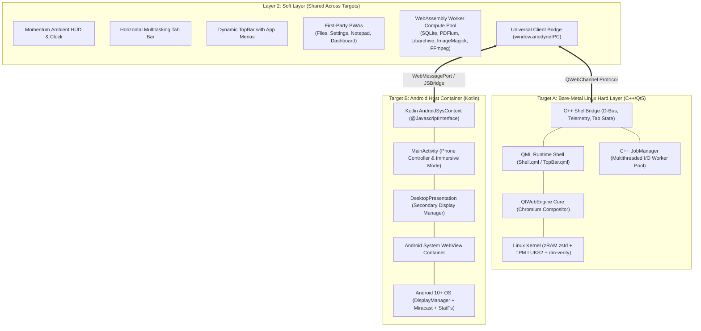
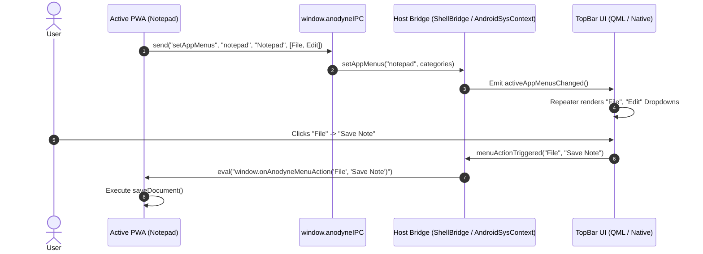
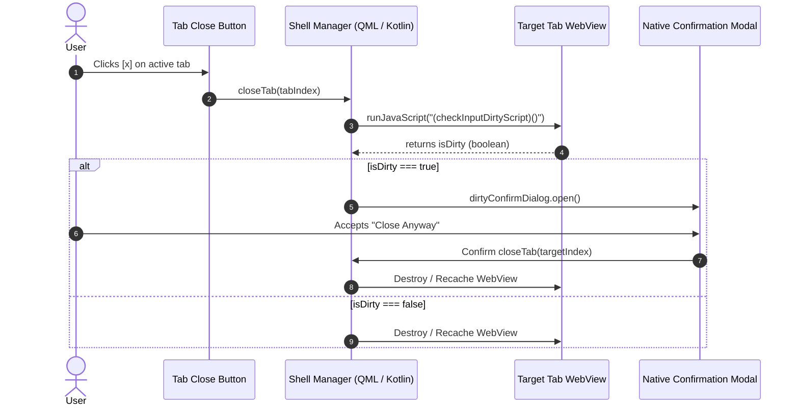
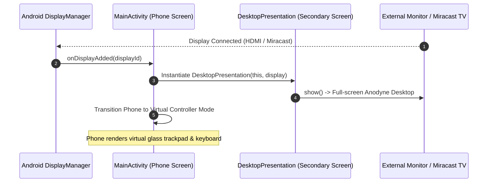
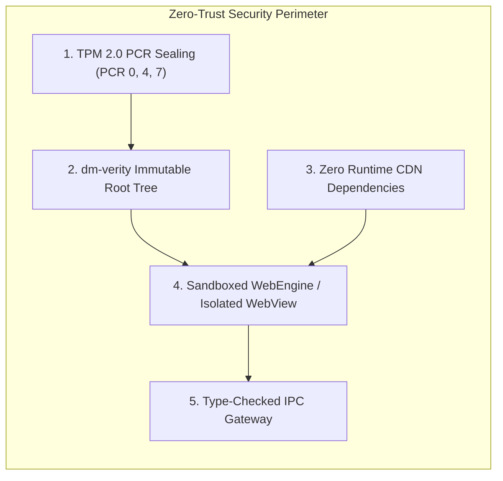

# System Architecture Document
## Project Anodyne OS: Dual-Target Web-First Desktop Framework

* **Document Version:** 1.0.0
* **System Identifiers:** `WebOS-Appliance` (Bare-Metal Linux) & `Anodyne-Desktop-Android` (Android Container)
* **Author:** Advanced Agentic Architecture Group
* **Status:** In Active Development / Production Hardening
* **Date:** October 2026

---

## 1. High-Level Architectural Topology

Anodyne OS is architected as a **Two-Layer Hybrid Computing Platform**:
1. **The Hard Layer (Native Host Shell):** Provides direct hardware abstraction, display rendering, OS security, process management, and telemetry services.
2. **The Soft Layer (Web Presentation & Compute):** Delivers the user-facing desktop shell, tabbed multitasking, progressive web applications (PWAs), and client-side WebAssembly computation workers.



---

## 2. Hard Layer vs. Soft Layer Separation

### 2.1 The Hard Layer (Native OS & Platform Host)
The Hard Layer is platform-specific and responsible for:
* **Display Output & Window Composition:** Spawning a borderless, full-screen hardware-accelerated canvas. On Linux, this is a kiosk X11 window. On Android, this is an immersive `Presentation` window rendered on secondary screens.
* **Hardware Abstraction & Telemetry:** Querying battery levels, network SSID, disk space, and memory statistics directly from kernel/system APIs without granting raw bash/terminal access to the web UI.
* **Persistent WebView State Management:** Retaining multiple WebViews in memory to achieve instantaneous context switches without reloading web assets.
* **Storage & Memory Hardening:**
  * **Linux:** Managing TPM 2.0 LUKS2 partitions, `dm-verity` root verification, and `/dev/zram0` compression.
  * **Android:** Enforcing WebView sandboxing (`allowFileAccess = false`, `allowContentAccess = false`), origin validation, and scoped storage access.

### 2.2 The Soft Layer (Web Presentation & Compute)
The Soft Layer is 100% portable and operates identically on both targets:
* **Zero-Network Packaging:** All styling (CSS custom properties), typography (system font stack), and iconography (Web Awesome inlined SVG vectors) are stored locally in the package.
* **Tab-Driven Multitasking:** Replaces window-snapping and taskbars with a browser-style horizontal tab registry.
* **WebAssembly Compute Offload:** Heavy computations (PDF rendering, ZIP compression, image conversion, SQLite indexing) run client-side in background Web Workers, completely decoupled from the UI thread.

---

## 3. Detailed Data & Control Flow Sequences

### 3.1 Dynamic Application Menu Registration & Dispatch
When an application tab (e.g. `Notepad`) loads, it registers category-based menus in the native TopBar. Clicks on the TopBar are dispatched directly back to the active page:



---

### 3.2 Tab Closure & Dirty Form Verification
To prevent accidental data loss, closing a tab triggers an introspection routine across all `input` and `textarea` DOM nodes before destroying the view:



---

### 3.3 Android Miracast / Secondary Display Plug & Play
When an Android smartphone detects an external monitor or wireless Miracast connection:



---

## 4. WebAssembly (WASM) Computation Subsystem

To guarantee responsiveness on 2GB RAM systems, CPU-intensive operations bypass the main JavaScript UI thread using a dedicated WebAssembly worker pool:

```text
web-apps/wasm_cores/
├── wasm_worker_pool.js          # Shared Worker thread pool orchestrator
├── sqlite_core.cpp / .js        # Relational database engine
├── pdfium_core.cpp / .js        # PDF parser & rasterizer
├── libarchive_core.cpp / .js    # Universal archive extractor (ZIP, TAR, 7Z)
├── imagemagick_core.cpp / .js   # Image manipulation engine
├── ffmpeg_core.js               # Audio/video transcode worker
├── tesseract_core.js            # Client-side OCR worker
└── transformers_core.js         # Small offline text embedding model
```

### Worker Pool Pipeline:
1. **Task Submission:** A PWA sends a job request with an `ArrayBuffer` payload to `wasm_worker_pool.js`.
2. **Zero-Copy Transfer:** Buffers are passed as Transferable Objects (`postMessage(msg, [msg.buffer])`) preventing memory duplication.
3. **WASM Execution:** The pre-initialized Emscripten C++ instance processes the data in its linear memory segment (`WebAssembly.Memory`).
4. **Result Resolution:** The worker posts the transformed buffer back to the PWA callback handler.

---

## 5. Security & Isolation Architecture



1. **Immutable Cryptographic Root (`dm-verity`):** The Linux root filesystem is mounted read-only and cryptographically verified at the block level against a SHA-256 hash tree.
2. **TPM 2.0 LUKS2 Key Binding:** User partitions are encrypted with AES-XTS. The encryption key is sealed in the TPM 2.0 hardware and only released if boot firmware, bootloader, and kernel integrity match known measurements (PCRs 0, 4, 7).
3. **Origin & Directory Isolation:**
   * Linux: Assets are resolved strictly via internal `anodyne://` scheme handler; local file browsing requires explicit user intent through the `Files` PWA.
   * Android: `allowFileAccess = false` and `allowContentAccess = false` prevent file exfiltration through injected HTML.
4. **Coordinate Clamping:** Touchpad/mouse coordinates received over wireless casting are sanitized and clamped between `[0.0, 1.0]` prior to dispatch, eliminating UI injection attacks.

---

## 6. Memory & Resource Optimization Model

To achieve fluid operation on 2GB RAM hardware, Anodyne uses a multi-tier memory management strategy:

$$\text{Total Virtual Memory} = \text{RAM}_{\text{Physical}} + 1.5 \times \text{RAM}_{\text{Physical}}\ (\text{zRAM zstd})$$

* **Aggressive Page Compression:** Setting `vm.swappiness = 150` directs the Linux kernel to swap idle anonymous memory pages into the zRAM pool using fast `zstd` compression rather than reclaiming active file caches.
* **WebView Dormancy:** Inactive tabs retain their DOM and JavaScript heap state, but animations and requestAnimationFrame loops are throttled to near-zero CPU consumption.
* **Purged Legacy Watchdogs:** All background monitoring is consolidated into event-driven C++ D-Bus and Qt signal slots, eliminating periodic Python polling daemons.
