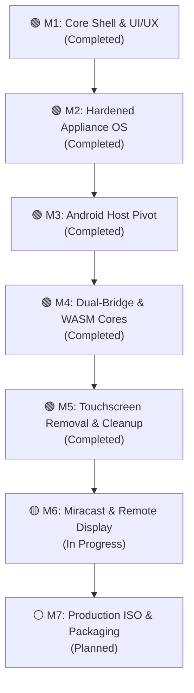

# Project Anodyne OS: Milestone Tasks & Progress Tracker

> **Project Identity:** Anodyne OS (formerly WebOS Appliance)  
> **Repository:** `WebOS-Appliance` (Bare-Metal Linux Appliance) & `Anodyne-Desktop-Android` (Android Host Container)  
> **Status:** Active Multi-Platform Desktop Convergence  
> **Last Updated:** October 2026

---

## 🗺️ Project Milestones & Progress Summary

---

## 🟢 Milestone 1: Core Shell & UI/UX Foundations (Completed)
**Goal:** Establish the minimal, distraction-free desktop shell using a hybrid Qt5/QML Hard Layer and HTML5/CSS3 Soft Layer.

- [x] **Modular QML Desktop Shell:** Engineered `Shell.qml`, `TopBar.qml`, `Theme.qml`, and `AppDrawer.qml` eliminating traditional desktop bloat.
- [x] **Browser-Tab Multitasking Architecture:** Replaced standard window managers and taskbars with a persistent tabbed app registry. Open WebViews persist in memory to eliminate re-renders on context switch.
- [x] **First-Party PWA Suite:**
  - `homepage`: Momentum-style dashboard with ambient clock, greeting, telemetry gauges, and quick launcher.
  - `files`: File manager interface reflecting dual-userland filesystem mounts with drag-and-drop.
  - `settings`: System control center for display, audio, network, and memory telemetry.
- [x] **Offline Zero-Trust Assets:** Bundled offline inline SVG icons (`web-apps/web-awesome/`) eliminating runtime CDN network dependencies.
- [x] **Spotlight Command Palette:** Global `Ctrl+Space` modal supporting app switching, calculations, and command dispatch.

---

## 🟢 Milestone 2: Hardened Appliance OS Foundation & Telemetry (Completed)
**Goal:** Implement hardware-level memory management, partition security, and Linux kernel telemetry on resource-constrained hardware (2GB–4GB RAM).

- [x] **TPM 2.0 PCR-Bound Cryptographic Storage:** Authored `setup-luks-tpm.sh` to seal LUKS2 disk encryption keys in TPM registers 0, 4, and 7.
- [x] **Read-Only Root Integrity (dm-verity):** Authored `setup-dm-verity.sh` computing SHA-256 block tree hashes to guarantee immutable system binaries.
- [x] **Memory Swap Compression (zRAM with zstd):** Configured `setup-zram.sh` with `zstd` compression allocated at 1.5x physical RAM and `vm.swappiness=150` to prevent OOM thrashing.
- [x] **Network Policy Routing:** Authored `setup-network-routing.sh` separating local casting interfaces (`wlan1`) from primary internet WAN modems (`wwan0`/`rmnet0`).
- [x] **Native C++ Telemetry Bridge:** Integrated real-time CPU, RAM, and zRAM metrics extraction in `ShellBridge.cpp` (`getCpuUsage()`, `getRamUsage()`, `getZramDiskSize()`).
- [x] **Legacy Code Purge:** Completely excised legacy `MemFusion` watchdog scripts and dialogs, migrating all telemetry queries directly into the C++ bridge.

---

## 🟢 Milestone 3: Android DeX-like Desktop Container Pivot (Completed)
**Goal:** Port the Anodyne desktop environment into a native Android Kotlin application targeting Android 10+ (API 29+), enabling Samsung DeX / secondary display productivity.

- [x] **Standalone Kotlin Android Workspace:** Initialized `/home/gagan/Projects/Anodyne-Desktop-Android` targeting modern Android SDK toolchains (Java 17, Gradle 8+).
- [x] **Hardware-Accelerated WebView Shell:** Implemented `MainActivity.kt` running full-screen immersive WebViews with hardware acceleration, DOM storage, and sandboxed asset loading.
- [x] **Android Native Bridge (`AndroidSysContext.kt`):** Exposed `BatteryManager`, `StatFs`, `WifiManager`, and `Intent` app launching to JavaScript via `@JavascriptInterface`.
- [x] **Secondary Display Convergence (`DesktopPresentation.kt`):** Bound desktop rendering to external monitors and wireless displays via Android's `DisplayManager` and `Presentation` API.
- [x] **PWA Asset Alignment:** Transferred and aligned dashboard assets into `app/src/main/assets/`.

---

## 🟢 Milestone 4: Dual-Bridge Convergence, Dynamic TopBar & WASM Cores (Completed)
**Goal:** Synchronize the advancements between the bare-metal appliance and the Android desktop app to achieve cross-platform code parity.

- [x] **Unified Single-File PWA Architecture:** Synced inlined, self-contained HTML/CSS/JS applications (`homepage`, `files`, `settings`, and new `notepad` PWA) across both repositories.
- [x] **Universal Dual-Bridge Protocol (`window.anodyneIPC`):** Added dynamic runtime environment detection inside PWA scripts:
  - If Qt `window.sysContext` exists: Routes commands through `QWebChannel`.
  - If Android `window.sysContext` exists: Routes calls directly through `@JavascriptInterface`.
- [x] **Dynamic TopBar Application Menus:**
  - Implemented `setAppMenus(...)` and `activeAppMenus` in `ShellBridge` and `TopBar.qml`.
  - PWAs publish custom macOS/DeX-style menus (e.g. *File -> New Note, Save Note*) on load.
  - Clicking menu items dispatches `window.onAnodyneMenuAction(category, item)` into the active tab.
- [x] **Tab Context Operations & Safety:**
  - Implemented right-click tab context menu: *Reload Tab*, *Duplicate Tab*, *Close Tab*, *Close Other Tabs*.
  - Added dirty-tab inspection: Runs JavaScript introspection on `input` and `textarea` fields before closing tabs, triggering a native confirmation dialog if unsaved edits exist.
- [x] **WebAssembly Worker Simulation Pool:** Synced client-side computation engines under `web-apps/wasm_cores/` (DuckDB, FFmpeg, Guacamole, ImageMagick, Libarchive, PDFium, SQLite, Tesseract, Transformers, WebTorrent).

---

## 🟢 Milestone 5: Codebase Sanitization & Non-Touchscreen Refinement (Completed)
**Goal:** Eliminate touch-specific heuristics, dead code, and unused system hooks across the bare-metal codebase.

- [x] **Excised C++ Touchscreen Heuristics:** Removed `QFileSystemWatcher` monitoring `/tmp/touchscreen_detected`, related slots, and signal emissions in `ShellBridge`.
- [x] **Removed QML Touch Interaction Handlers:** Deleted `MultiPointTouchArea` dynamic scaling (+20%) from `Shell.qml`.
- [x] **Cleaned TopBar Status Indicators:** Removed `inputModeHint` visual layouts and variables from `TopBar.qml`.
- [x] **Diagnostics Normalization:** Updated the system diagnostics sidebar to permanently report `Input Mode: Precision / Desktop`.
- [x] **Local Build & CI Validation:** Recompiled clean binary (`AnodyneOS`) with zero warnings and pushed to GitHub triggering automated CI passes.

---

## 🟡 Milestone 6: Miracast & Remote Display Convergence (In Progress)
**Goal:** Deliver zero-latency secondary screen casting and mobile-as-controller interaction.

- [x] **Android Remote Server Foundation:** Created `DesktopRemoteServer.kt` in `Anodyne-Desktop-Android` for remote control event parsing.
- [x] **Display Detection Plumbing:** Built `DisplayListener` integration in Android to spin up desktop sessions on Miracast/HDMI connections.
- [ ] **Mobile Virtual Touchpad & Controller Mode:**
  - Primary phone screen renders a dedicated virtual trackpad, media controls, and quick app switcher while the secondary display renders the full Anodyne desktop.
- [ ] **WebRTC Screen Casting Pipeline:**
  - Real-time video/audio streaming fallback for non-Miracast displays via browser-based WebRTC client.
- [ ] **Clamped Remote Pointer Navigation:**
  - Sub-pixel pointer tracking with absolute coordinate normalization `[0.0, 1.0]` for low-latency wireless control.

---

## ⚪ Milestone 7: Production Packaging, ISO & Deployment (Planned)
**Goal:** Deliver turnkey deployment images for both bare-metal installation and Android app distribution.

- [ ] **Lubuntu Live-Build ISO Generation:** Automated build script (`build-iso.sh`) producing bootable hybrid ISO (`live-image-amd64.hybrid.iso`) with immutable `dm-verity` root.
- [ ] **Production Android Release Build:** Signed release AAB/APK distribution package with ProGuard/R8 optimizations and asset compression.
- [ ] **Offline Factory Powerwash Utility:** Script `powerwash.sh` executing secure erase of TPM-sealed LUKS volumes to restore initial factory state.
- [ ] **Comprehensive Test Automation:** End-to-end integration test suite verifying IPC bridge latency, tab memory leaks, and WASM computation throughput.
