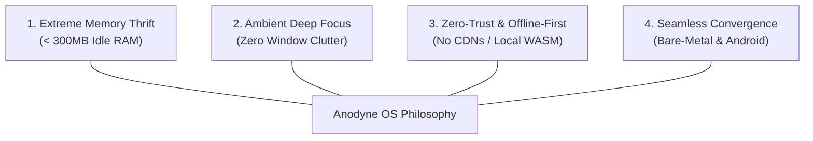

# Product Requirements Document (PRD)
## Project Anodyne OS: Dual-Target Web-First Desktop Environment

* **Document Version:** 1.0.0
* **Product Name:** Anodyne OS / Anodyne Desktop
* **Target Platforms:** Bare-Metal Linux Appliance (x86_64) & Android Host Container (Android 10+ / API 29+)
* **Status:** In Active Development / Production Hardening
* **Date:** October 2026

---

## 1. Executive Summary

**Anodyne OS** is a lightweight, zero-trust, distraction-free desktop computing platform built around a web-first paradigm. It completely reimagines modern operating system interfaces by discarding windowing clutter, system tray bloat, and overlapping desktop windows in favor of a clean **Momentum-style ambient dashboard** and a **persistent horizontal tabbed multitasking shell**.

To maximize accessibility, Anodyne delivers a **Dual-Target Convergence Model**:
1. **Bare-Metal Linux Appliance (`WebOS-Appliance`):** A custom immutable Linux OS built with Qt 5 / QML and `QtWebEngine`, tailored for low-spec or legacy hardware (2GB–4GB RAM).
2. **Android Desktop Container (`Anodyne-Desktop-Android`):** A native Android application that transforms any Android 10+ phone into a Samsung DeX-style desktop environment via wireless display casting (Miracast) or USB-C DisplayPort Alt-Mode, utilizing the phone's primary screen as a multi-touch trackpad and controller.

Both targets deliver a consistent visual and functional user experience, utilizing the same first-party Progressive Web Applications (PWAs), inlined offline assets, client-side WebAssembly computation engines, and dynamic application menus.

---

## 2. Problem Statement & Market Opportunity

### 2.1 The Problem
* **Operating System Bloat & Planned Obsolescence:** Modern operating systems (Windows 11, macOS Sequoia) demand 8GB–16GB of RAM, dedicated GPUs, and gigabytes of storage just to run idle background services, telemetry agents, and AI sidecars. Millions of functional 2GB–4GB RAM PCs are discarded annually.
* **Mobile-to-Desktop Gap:** While smartphones possess powerful multi-core processors, desktop convergence (e.g. Samsung DeX, Motorola Ready For) remains locked behind expensive proprietary ecosystems. Pure Android on external monitors renders stretched mobile phone interfaces rather than a real desktop workspace.
* **Digital Distraction & Cognitive Fatigue:** Traditional desktop window managers promote window chaos, pop-up notifications, and context-switching fatigue, degrading deep focus.

### 2.2 The Solution
Anodyne OS solves these challenges by combining:
* An **ultra-lean system footprint** (< 300MB idle RAM usage).
* A **web-first tabbed multitasking layout** where every application behaves like an instantaneous browser tab with persistent in-memory state.
* An **offline-first, zero-trust posture** where core applications and WebAssembly tools run entirely on-device without third-party CDN tracking or cloud dependencies.
* A **universal secondary display experience** that turns ordinary Android phones into desktop work environments over standard Miracast receivers.

---

## 3. User Personas & Core Use Cases

### 3.1 Persona Profiles

| Persona | Role | Key Needs | Pain Points Solved |
| :--- | :--- | :--- | :--- |
| **Elena (The Focus Worker / Writer)** | Technical Writer & Researcher | Clean, distraction-free text editor, ambient music/clock, zero desktop clutter. | Overwhelmed by notifications, browser tab explosion, and complex window snapping. |
| **Devon (The Legacy Hardware Rescuer)** | Student / Open Source Enthusiast | Fast, responsive OS on a refurbished 4GB RAM laptop for programming and web apps. | Windows 11 is unusable on 4GB RAM; Linux desktop environments (GNOME/KDE) have heavy RAM footprints. |
| **Raj (The Mobile-First Traveler)** | Field Operations Specialist | Ability to connect Android phone to hotel TV or conference monitor and work on documents. | Doesn't own a Samsung device for DeX; standard Android screen mirroring is unusable for productivity. |

### 3.2 Primary User Journeys
1. **Distraction-Free Deep Work:** The user boots into the Anodyne desktop. The screen presents an ambient clock, greeting, and curated quote. The user presses `Ctrl+Space` to launch `Notepad`, takes notes, and effortlessly switches between `Files` and research tabs using `Alt+1..9` without window overlap.
2. **Wireless Desktop Convergence (Android $\rightarrow$ Miracast):** The user connects their phone wirelessly to a Miracast TV. The TV immediately transitions to the full Anodyne OS desktop view with topbar menus and web apps. The phone screen turns into a virtual glass touchpad and keyboard controller.
3. **Offline Document Processing:** The user drops a PDF or ZIP archive into the Files PWA. Local WebAssembly workers (PDFium, Libarchive) extract, inspect, and hash the file locally without transferring bytes to any remote server.

---

## 4. Product Pillars & Design Principles

1. **Extreme Memory Thrift:** The operating environment must operate smoothly on 2GB RAM. Idle memory footprint must not exceed 300MB.
2. **Ambient Deep Focus:** No floating, overlapping, or minimized windows. Work is organized into dedicated, single-context tabs. UI controls fade into the background when not active.
3. **Zero-Trust & Offline-First:** The system contains zero external runtime CDN links. All styles, icons (Web Awesome inline SVG), and fonts are bundled within the root image or package.
4. **Seamless Dual Convergence:** Features developed for the web dashboard and applications must operate identically across both bare-metal Linux and Android container targets.

---

## 5. Functional Requirements

### 5.1 System Shell & Navigation Layer (Hard Layer)
* **FR-1.1 Full-Screen Kiosk Container:** The shell shall launch full-screen without title bars, system borders, or desktop clutter.
* **FR-1.2 TopBar System Navigation:**
  * Displays system status icons (Wi-Fi network status, battery level, current time).
  * Hosts the *Anodyne Application Drawer* trigger on the far left.
  * Dynamically populates context menus (e.g. `File`, `Edit`, `View`) registered by the currently active PWA.
  * Dispatches menu actions to the focused PWA via the IPC bridge (`window.onAnodyneMenuAction`).
* **FR-1.3 Horizontal Tabbed Multitasking Bar:**
  * Displays all open application tabs horizontally below or integrated with the TopBar.
  * Visual indicators for active tab, tab icon, and individual close buttons.
  * Context Menu on Right-Click: Offers *Reload Tab*, *Duplicate Tab*, *Close Tab*, and *Close Other Tabs*.
  * Keyboard navigation: `Ctrl+W` closes active tab; `Ctrl+T` / `Ctrl+Space` launches command palette; `Alt+[1-9]` switches to specific tabs.
* **FR-1.4 Tab Lifecycle & In-Memory State Preservation:**
  * Switching tabs must preserve DOM state, scroll position, and form input without reloading the page.
  * Closing a tab with dirty form input (`input`, `textarea`) triggers a native safety dialog prompt (*"You have unsaved changes in this tab. Close anyway?"*).
* **FR-1.5 Spotlight Command Palette:**
  * Activated by `Ctrl+Space`.
  * Allows real-time search across installed apps, open tabs, and mathematical evaluations.

### 5.2 First-Party PWA Suite (Soft Layer)
* **FR-2.1 Home Dashboard (`homepage`):**
  * Minimalist ambient HUD featuring real-time clock, personalized greeting, daily motivational quote, and quick launcher tiles.
  * Real-time hardware telemetry gauges (CPU load, memory allocation, storage health).
* **FR-2.2 File Manager (`files`):**
  * Visual dual-userland filesystem browser.
  * Drag-and-drop file upload target with integrated SHA-256 WebAssembly cryptographic hashing.
  * Asynchronous file copy, move, and delete actions with progress bar visualization.
* **FR-2.3 System Settings (`settings`):**
  * Hardware controls for display brightness, system volume, and wireless network connections.
  * Real-time memory telemetry displaying zRAM compression ratio, algorithm (`zstd`), and swappiness.
* **FR-2.4 Notepad (`notepad`):**
  * Minimalist distraction-free Markdown/text editor with persistent local storage caching.
  * Dynamic TopBar menu registration (`File` -> *New Note, Open, Save, Export*).

### 5.3 WebAssembly Computation Core Pool
* **FR-3.1 Background Worker Pipeline:** Client-side compute operations must run in background Web Workers without blocking the UI thread.
* **FR-3.2 Compute Cores Supported:**
  * `sqlite_core`: Relational database operations in local memory.
  * `pdfium_core`: PDF rendering and text extraction.
  * `libarchive_core`: Multi-format archive extraction (ZIP, TAR, GZ, 7Z).
  * `imagemagick_core`: Image format conversion and resizing.
  * `tesseract_core`: Offline OCR optical character recognition.
  * `ffmpeg_core`: Media audio/video transcoding.

### 5.4 Android Convergence & Wireless Display (Android Target)
* **FR-4.1 Automatic Display Detection:** When connected to an external screen (USB-C Alt Mode, HDMI, or wireless Miracast), the app must auto-launch a full-screen desktop presentation via `DisplayManager` and `Presentation`.
* **FR-4.2 Primary Screen Controller:** While secondary display runs the desktop session, the smartphone screen renders a virtual multi-touch trackpad, soft keyboard, and status HUD.

---

## 6. Non-Functional Requirements (NFRs)

| ID | Category | Requirement Specification |
| :--- | :--- | :--- |
| **NFR-1** | **Memory Footprint** | Baseline idle memory usage must remain $\le 300\text{ MB}$ RAM on bare-metal and $\le 250\text{ MB}$ PSS on Android. |
| **NFR-2** | **Boot & Launch Time** | Cold shell startup to responsive interactive dashboard must occur in $\le 3.0\text{ s}$ on standard SATA SSD / UFS 2.1 storage. |
| **NFR-3** | **Tab Switching Latency** | Switching active tabs must occur in $\le 16\text{ ms}$ (60 FPS), with zero page reloads. |
| **NFR-4** | **Offline Operation** | 100% of core UI and first-party applications must render and function without internet access. |
| **NFR-5** | **Zero Telemetry** | No outbound tracking, analytics, crash pings, or telemetry transmitted across network interfaces. |
| **NFR-6** | **Security & Sandboxing** | Linux root filesystem protected by cryptographic `dm-verity` hash tree; user partitions encrypted via TPM 2.0-bound LUKS2. Android WebView restricts local file access (`allowFileAccess=false`). |

---

## 7. Metrics & Key Performance Indicators (KPIs)

* **System Resource Efficiency:** Memory usage under 4 concurrent active tabs (Homepage, Files, Settings, Notepad) $\le 650\text{ MB}$ RAM.
* **Zero-Crash Multitasking:** Zero out-of-memory kernel panic crashes on 2GB RAM test fixtures under sustained heavy workload (guaranteed by `zRAM zstd` priority swap).
* **Display Connection Latency:** Auto-detect and render secondary desktop UI on external screen in $\le 800\text{ ms}$ from HDMI/Miracast handshake.
