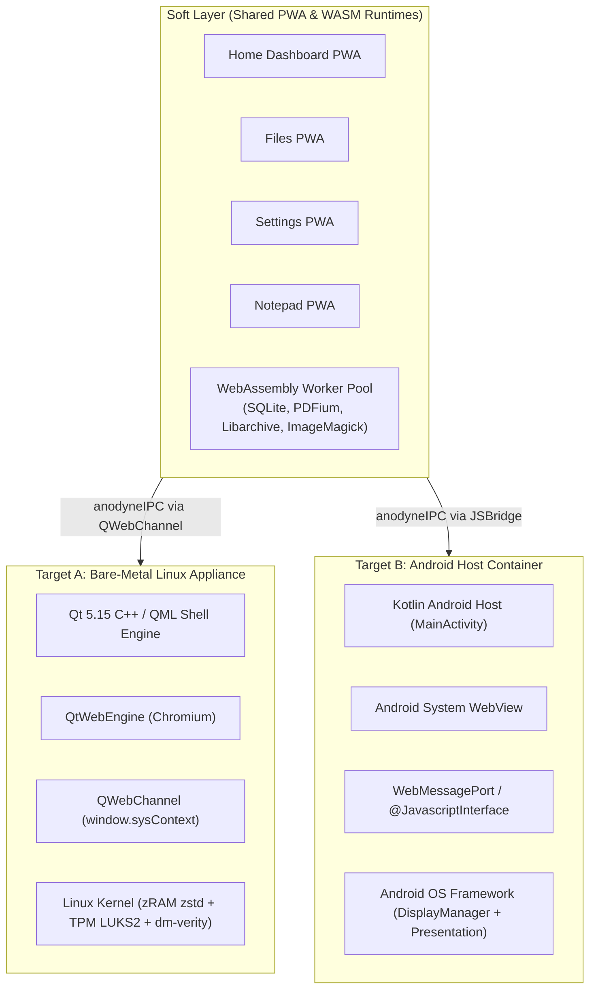
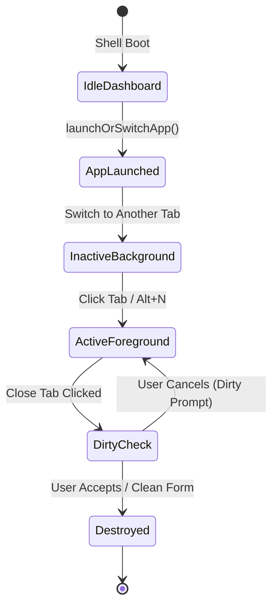

# Technical Requirements Document (TRD)
## Project Anodyne OS: Dual-Target Web-First Desktop Environment

* **Document Version:** 1.0.0
* **Target Architecture:** x86_64 Linux Appliance & ARM64 / x86_64 Android Host (API 29+)
* **Core Runtimes:** Qt 5.15 / QtWebEngine (Chromium) & Android Kotlin / Android System WebView
* **Status:** In Active Development / Production Hardening
* **Date:** October 2026

---

## 1. Architectural Scope & Runtime Environments

Anodyne OS executes across two distinct hardware and runtime targets while sharing an identical Soft Layer (HTML5/CSS3/PWA/WASM) frontend:



---

## 2. Technical Specifications Matrix

| Dimension | Target A: Bare-Metal Appliance | Target B: Android Host Container |
| :--- | :--- | :--- |
| **Host OS** | Debian Minimal / Lubuntu (x86_64) | Android 10.0+ (API Level 29+), ARM64 / x86_64 |
| **Core Runtime** | Qt 5.15.x LTS (Core, Quick, WebEngine, DBus) | Kotlin 1.9+, AndroidX, Coroutines |
| **Rendering Engine** | Chromium via `QtWebEngineCore` | Chromium via `android.webkit.WebView` |
| **Display Server / Windowing** | X11 (Full-screen kiosk mode, `-nocursor`) | Android WindowManager & `DisplayManager` |
| **Secondary Display Tech** | Xorg Dual-Head / Output autoconfig | `android.app.Presentation` API / Miracast |
| **IPC Bridge Architecture** | `QWebChannel` registered C++ object (`sysContext`) | `@JavascriptInterface` / `WebMessagePort` (`sysContext`) |
| **Memory Compression** | Kernel `/dev/zram0` (zstd, `swappiness=150`) | Android LMK (Low Memory Killer) + zRAM |
| **Root Integrity / Encryption** | `dm-verity` SHA-256 tree + TPM 2.0 LUKS2 | Android dm-verity / FBE (File-Based Encryption) |
| **Local Asset Resolution** | Custom URL scheme `anodyne://` | Android Asset Pack `file:///android_asset/` |

---

## 3. Host Layer Engine Specifications

### 3.1 Target A: Qt5 / QML System Architecture (`WebOS-Appliance`)

```text
src/
├── main.cpp                     # Application entry point, QQuickView & QWebEngine setup
├── ShellBridge.h / .cpp         # C++ QWebChannel bridge, telemetry provider, tab manager
├── JobManager.h / .cpp          # Multithreaded asynchronous background I/O pool
└── AnodyneUrlSchemeHandler.h    # QWebEngineUrlSchemeHandler for secure anodyne:// resolution
ui/
├── Shell.qml                    # Root QML container, tabbed multitasking canvas, lock screen
├── TopBar.qml                   # Modular topbar, status indicators, dynamic menu repeater
├── Theme.qml                    # Centralized design tokens (colors, radii, typography)
└── components/                  # AppDrawer, StatusIndicator, TopBarIcon
```

#### Key Class Responsibilities:
* **`ShellBridge`:**
  * Implements `Q_PROPERTY` exports: `currentMode`, `tabs`, `currentTabIndex`, `activeAppMenus`.
  * Slots: `launchOrSwitchApp()`, `closeTab()`, `closeOtherTabs()`, `reloadTab()`, `setAppMenus()`, `executeSystemCommand()`.
  * Telemetry extraction from Linux virtual filesystems:
    * CPU Usage: Parsing `/proc/stat` active vs idle delta ticks.
    * Memory Usage: Parsing `/proc/meminfo` (`MemTotal`, `MemAvailable`).
    * zRAM Telemetry: Parsing `/sys/block/zram0/disksize` and `/sys/block/zram0/comp_algorithm`.
  * D-Bus Notification Receiver: Implements `org.freedesktop.Notifications` D-Bus interface.
* **`JobManager`:**
  * Manages `QThreadPool` for heavy background operations.
  * Emits `nativeJobProgressChanged(jobId, progress)` and `nativeJobFinished(jobId, success, message)`.

### 3.2 Target B: Android Native Architecture (`Anodyne-Desktop-Android`)

```text
app/src/main/java/com/anodyne/desktop/
├── MainActivity.kt              # Primary phone activity, permission setup, controller mode
├── DesktopPresentation.kt       # Presentation window running full-screen on secondary display
├── AndroidSysContext.kt         # @JavascriptInterface bridge implementation
├── DesktopRemoteServer.kt       # Local HTTP/WebSocket server for remote mobile inputs
└── DesktopUiHelper.kt           # Immersive full-screen window configuration utilities
```

#### Key Class Responsibilities:
* **`AndroidSysContext`:**
  * `@JavascriptInterface getBatteryLevel()`: Reads `BatteryManager.EXTRA_LEVEL`.
  * `@JavascriptInterface getStorageStatus()`: Calculates available bytes using `StatFs(Environment.getDataDirectory().path)`.
  * `@JavascriptInterface getWifiSSID()`: Reads `WifiManager.connectionInfo.ssid`.
  * `@JavascriptInterface launchApp(packageName)`: Triggers Android `Intent` to launch external apps.
* **`DesktopPresentation`:**
  * Extends `android.app.Presentation(context, display)`.
  * Hosts dedicated `WebView` on external HDMI or Miracast wireless display.
  * Handles secondary screen density adjustments and focus routing.

---

## 4. Universal Inter-Process Communication (IPC) Protocol

To ensure 100% interoperability between PWAs and either host, all client-side web apps communicate through the unified `window.anodyneIPC` abstraction:

```javascript
// Universal Client-Side Bridge Adapter (Included in every PWA)
window.anodyneIPC = {
    send: function(action, ...args) {
        // Mode 1: Qt QWebChannel Bridge
        if (window.sysContext && typeof window.sysContext[action] === 'function') {
            window.sysContext[action](...args);
            return;
        }
        // Mode 2: Android JavascriptInterface Bridge
        if (window.androidContext && typeof window.androidContext[action] === 'function') {
            window.androidContext[action](...args);
            return;
        }
        console.warn("[anodyneIPC] No active native bridge found for action:", action);
    }
};
```

### 4.1 IPC Event & Payload Schemas

#### 1. Dynamic Application Menu Registration (`setAppMenus`)
* **Direction:** PWA $\rightarrow$ Host
* **Signature:** `setAppMenus(tabId: String, appName: String, categories: Array<Object>)`
* **Payload Structure:**
  ```json
  {
    "tabId": "notepad",
    "appName": "Notepad",
    "categories": [
      {
        "category": "File",
        "items": ["New Note", "Open Note...", "Save Note", "Export Markdown"]
      },
      {
        "category": "Edit",
        "items": ["Undo", "Redo", "Find & Replace", "Clear Document"]
      }
    ]
  }
  ```

#### 2. Menu Action Dispatch (`onAnodyneMenuAction`)
* **Direction:** Host $\rightarrow$ PWA
* **Signature:** `window.onAnodyneMenuAction(category: String, item: String)`
* **Execution:** Host evaluates JavaScript in focused `WebEngineView` / `WebView`.

#### 3. Tab Management Calls
* `launchOrSwitchApp(appId: String, url: String, title: String)`
* `closeTab(index: Int)`
* `closeOtherTabs(index: Int)`
* `reloadTab(index: Int)`

---

## 5. Multitasking, WebViews & Dirty State Inspection

### 5.1 Tab Registry State Machine
The multitasking model preserves open WebViews in memory to guarantee instantaneous tab switches ($\le 16\text{ ms}$):



### 5.2 Dirty Form Introspection Engine
Before any tab is closed, the shell injects an introspection routine into the target WebView:

```javascript
(function() {
    var dirty = false;
    document.querySelectorAll('input, textarea').forEach(function(el) {
        if (el.value && el.value.trim() !== '' && 
            el.type !== 'submit' && el.type !== 'button' && el.type !== 'hidden') {
            dirty = true;
        }
    });
    return dirty;
})();
```
* If `isDirty === true`: Spawns a native modal `Dialog` prompt (`dirtyConfirmDialog` in QML; `AlertDialog` in Android).
* If user accepts or `isDirty === false`: Calls native `closeTab(index)` disposing of the tab and reallocating focus.

---

## 6. WebAssembly (WASM) Computation Infrastructure

Heavy compute operations are isolated into a client-side Web Worker pool (`web-apps/wasm_cores/wasm_worker_pool.js`) preventing UI stutters:

### 6.1 WASM Core Specifications

| Core Module | Source Engine | Emscripten Build Flags | Primary Function |
| :--- | :--- | :--- | :--- |
| `sqlite_core` | SQLite 3.42 | `-O3 -sWASM=1 -sALLOW_MEMORY_GROWTH` | In-memory relational database & indexing |
| `pdfium_core` | Google PDFium | `-O3 -sWASM=1 -sEXPORTED_RUNTIME_METHODS` | Vector PDF rasterization & page extraction |
| `libarchive_core` | Libarchive 3.7 | `-O3 -sWASM=1 -sEXTRA_EXPORTED_RUNTIME_METHODS` | Multi-format archive unpacker (ZIP, 7Z, TAR, GZ) |
| `imagemagick_core` | ImageMagick 7 | `-O3 -sWASM=1 -sTOTAL_MEMORY=64MB` | Client-side image transcoding & filters |
| `tesseract_core` | Tesseract OCR | Precompiled WebAssembly / SIMD | Offline optical character recognition |
| `ffmpeg_core` | FFmpeg 5.x | WebAssembly SIMD / Threads enabled | Audio & video transcoding pipelines |

---

## 7. Linux Appliance Hardening & Security Specifications

### 7.1 TPM 2.0 LUKS2 Cryptographic Volume Binding
* **Script:** `scripts/setup-luks-tpm.sh`
* **Mechanism:**
  1. Generates 64-byte high-entropy random key.
  2. Formats user data partition (`/dev/sdb3` or `/dev/nvme0n1p3`) with `luksFormat --type luks2 --cipher aes-xts-plain64`.
  3. Uses `clevis luks bind -d /dev/sdb3 tpm2 '{"pcr_bank":"sha256","pcr_ids":"0,4,7"}'` to bind decryption keys to BIOS firmware (PCR 0), MBR/bootloader (PCR 4), and Secure Boot status (PCR 7).
  4. Any unauthorized modification to the kernel or bootloader prevents the TPM from releasing the master encryption key.

### 7.2 Read-Only Root Filesystem Integrity (dm-verity)
* **Script:** `scripts/setup-dm-verity.sh`
* **Mechanism:**
  1. Compresses immutable system root into a SquashFS image.
  2. Computes hierarchical SHA-256 block tree hashes using `veritysetup format`.
  3. Exports the `Root Hash` into the kernel command line parameters (`ro verity.root_hash=...`).
  4. Linux kernel cryptographically verifies every 4096-byte block read into memory at runtime; modified blocks cause instant I/O aborts.

### 7.3 High-Performance Memory Compression (zRAM)
* **Script:** `scripts/setup-zram.sh`
* **Parameters:**
  * Compression Algorithm: `zstd` (optimal balance of throughput and ratio).
  * Capacity: Dynamic allocation at $1.5 \times \text{Total System RAM}$.
  * Priority: `32767` (highest Linux swap priority).
  * Swappiness: `vm.swappiness = 150` (forces kernel to aggressively compress anonymous memory pages before thrashing disk I/O).

---

## 8. Android Wireless Display & Input Convergence (Miracast)

### 8.1 Display Lifecycle Engine
* **Listener:** `DisplayManager.DisplayListener` registered in `MainActivity.kt`.
* **State Transition:**
  * When `onDisplayAdded(displayId)` fires, query `display.flags & Display.FLAG_PRESENTATION`.
  * Instantiate `DesktopPresentation(this, display)`.
  * Call `presentation.show()` to render full-screen Anodyne Desktop onto external display (1080p@60Hz or 4K@60Hz).
* **Primary Screen Role:** Phone screen switches from desktop mode to **Virtual Controller Mode**:
  * Glass touchpad capturing multi-touch gestures.
  * Soft keyboard summoner.
  * Quick app launcher dock and media remote.

### 8.2 Sub-Pixel Coordinate Clamping
To protect against remote script injection and out-of-bounds pointer drift, all remote mouse coordinates sent to the desktop session are clamped:

$$\begin{aligned}
x_{\text{normalized}} &= \max(0.0, \min(1.0, x / W_{\text{trackpad}})) \\
y_{\text{normalized}} &= \max(0.0, \min(1.0, y / H_{\text{trackpad}})) \\
X_{\text{desktop}} &= x_{\text{normalized}} \times W_{\text{presentation}} \\
Y_{\text{desktop}} &= y_{\text{normalized}} \times H_{\text{presentation}}
\end{aligned}$$
